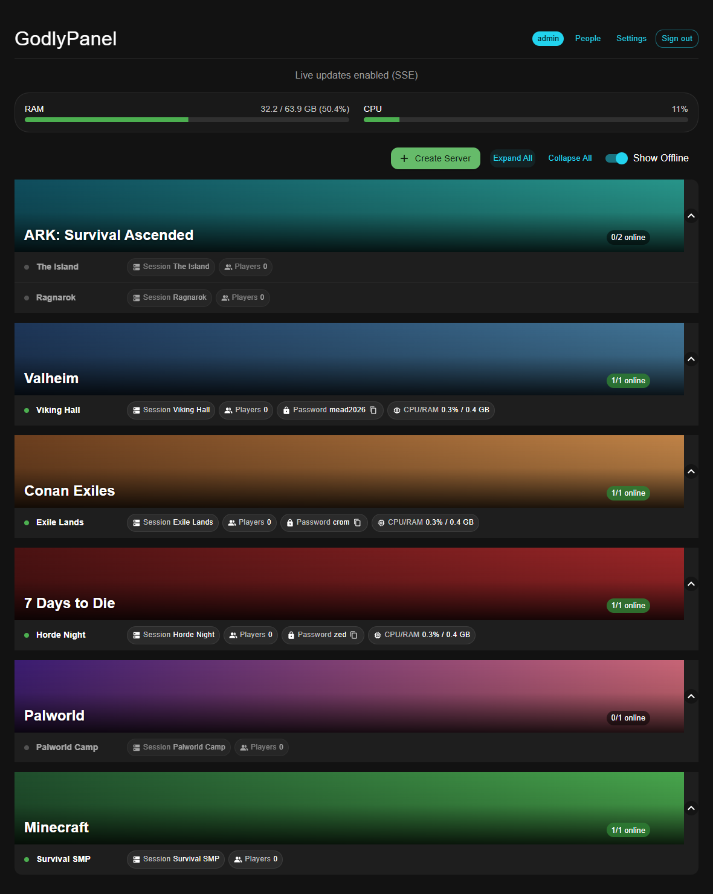
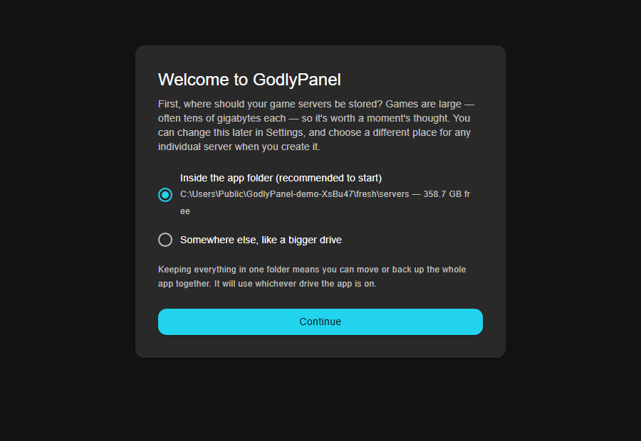
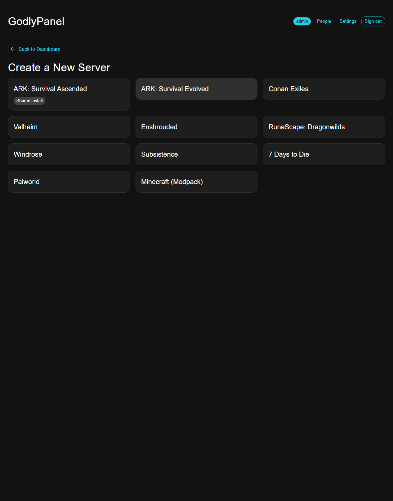
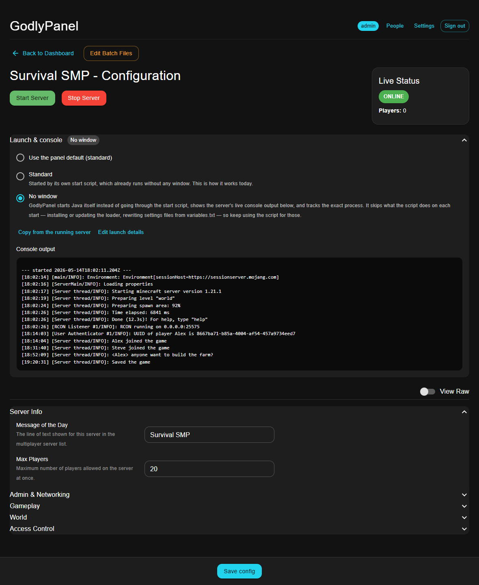
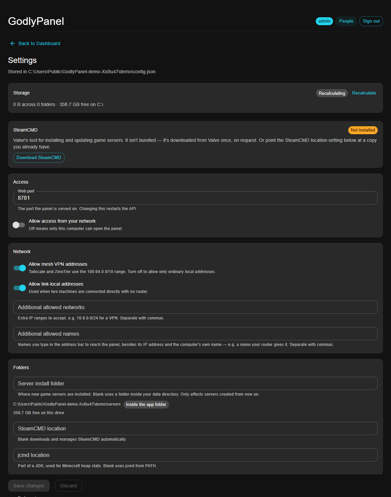

# GodlyPanel

**An all-in-one control panel for running game servers on a Windows PC.** Download a
zip, unpack it, run `GodlyPanel.exe`. There's no separate website to host, no tunnel,
no database to install, and no command line. Everything it needs, including its own
web server and its own data, lives in that one folder.

Create servers from templates for **93 games**, start and stop them, watch their status,
edit their config files, install mods, keep them backed up and updated, move them to another
PC, and give the people in your community a read-only view of what's running. The panel is
available in English, Spanish and German.



> **Status: alpha (v0.1.0-alpha.24).** It runs a real community's servers day to day, and
> there are [releases](https://github.com/Vulcanie/GodlyPanel/releases) (all marked
> pre-release), but it has been tried on very few PCs and there will be rough edges. See
> [Known limitations](#known-limitations) before you trust it with anything you can't
> afford to redo.

---

## How this was built (please read this)

I'll be straightforward about it, because you're being asked to run this on your
computer and trust it with your game servers:

- **This app is built with [Claude Code](https://www.anthropic.com/claude-code),**
  Anthropic's AI coding agent. Nearly all of the code was written by Claude, working
  with me in a terminal session.
- **I'm one developer,** running a community's game servers as a hobby, on a **Claude
  Pro plan**. There's no team, no company, and no budget. I direct the work, decide
  what it should do, run it against my own servers, and review what comes back.
- **The code has not had an independent security audit.** It has an extensive
  automated test suite (thousands of tests, described [below](#tests)), and the design
  choices are written down in [SECURITY.md](SECURITY.md), but that isn't the same as
  a professional review. The threat model is a trusted home or community network, not
  the internet.
- **It is improving in every direction as I go:** performance, security, and features.
  Recent work has included an audit pass over the whole app (hardening login, closing
  a DNS-rebinding hole, cutting the app's background process launches, shrinking the
  package by 25 MB), new ways of running servers with no taskbar clutter, signed
  self-updates, 76 more games added from sourced research (each with its own tests),
  custom roles, mods from several sources, a file manager, moving a server to another PC,
  smaller backups, and Spanish and German translations. The commit history and the
  [release notes](https://github.com/Vulcanie/GodlyPanel/releases) are the honest record
  of what changed and why.

If AI-written software isn't something you're comfortable running, that's a perfectly
reasonable position. If it is, I've tried to make the code, the tests, and the
reasoning behind each decision easy to check for yourself: comments explain *why*, and
commit messages describe the problem each change solved.

---

## What it does

- **Creates game servers for you.** Pick a game from [93 templates](#supported-games), name
  it, choose ports (it suggests free ones), and the panel downloads the server, writes a
  working start script and config, and registers it. No editing batch files by hand. Most
  games come through SteamCMD; Minecraft and Terraria come from their makers' own sites or
  GitHub, and only after you agree to the download, with a checksum checked where one is published.
- **Monitors them live.** Online/offline, player counts, ping, CPU and RAM per server,
  and JVM heap use for Minecraft, updated live as things change.
- **Starts, stops and updates them.** Graceful stops (saving the world first where the
  game supports it), one-click updates through SteamCMD, an RCON console where a game
  has one, and optional automatic updates with an in-game countdown.
- **Makes game updates safe to try.** A server can be backed up automatically before each
  game update (and the update is not run if that backup fails); afterwards the panel waits for
  the server to come back online, says so if it doesn't, and offers to roll the save files
  back to the pre-update backup. (Game files themselves are not rolled back.)
- **Edits config files** through a form when it knows the format, or as raw text,
  keeping a `.bak` of whatever it replaces. Every setting of a game the panel knows has an
  explanation beside it, and the launch arguments of each game are listed and explained too
  ([game settings](docs/GAME_SETTINGS.md), [launch arguments](docs/LAUNCH_ARGUMENTS.md)).
- **Changes a server's ports safely.** Every change is checked as you type against the
  server's own other ports, the ports its game quietly takes for itself, every other
  server, and the panel's own port. For every game, the port right after the game port is
  kept free: Conan Exiles and ARK: Survival Evolved use it for a raw socket, Valheim uses
  the next two and 7 Days to Die the next three, and for the rest it's reserved in case.
  The Create Server button stays disabled while a query or RCON port sits on one. It then updates the start script, the game's config and the panel's
  record together, with a `.bak` of each file.
- **Deletes servers completely,** or just removes them from the panel. Deleting files is
  only offered for servers the panel created, never for a shared install other servers
  use, never for a protected location, and only after you type the server's name.
- **Backs up your worlds.** One click, or on a schedule: the game's save folders (or ones
  you choose) are archived, checked by reading the archive back, and kept under rules you set
  (how many, how old, or a spread of daily, weekly and monthly copies). Backups can be `.zip`
  or the smaller `.tar.zst` and `.tar.xz`, at a speed you choose, and a scheduled backup is
  skipped when nothing has changed. A game that can't be saved on command is stopped for the
  copy and started again. Restoring is one click ("Restart and use this backup"): it takes a
  safety backup of what it replaces first, and puts things back if any step fails.
- **Looks after servers.** Restart one if it crashes (with a limit, so a server that
  crashes on every start is given up on loudly instead of looped), start chosen servers
  when the panel starts, and start the panel itself when you sign in to Windows. A
  server shows "Starting…", "Stopping…" or "Backing up…" while it is, and won't accept
  a second action until it's done.
- **Runs schedules.** Backups, restarts (with "restarting in 10, 5, 1 minutes" messages
  in the game), game updates and console commands, daily, on chosen days, every few
  hours, or once.
- **Shows what's going on.** Per-server logs you can follow live and search, who is on
  and who has been (joins, leaves, time played), and an activity log (with who did what, exportable as CSV or JSON Lines, and an optional audit webhook) of everything the
  panel did and everything that happened. Passwords in logs are masked for anyone but an
  administrator.
- **Tells you when something needs attention:** a Windows notification, a webhook
  (Discord, Slack and similar) and email, for crashes, failed backups or restarts, backups that never reach their off-site
  destination, low disk space and new versions. You choose which events.
- **Shows where you are signed in.** A Sessions list per account: end any sign-in you don't recognise, or sign out
  everywhere else; administrators can do it for anyone.
- **Has roles you can shape.** Three are built in: viewers look; **moderators** run servers
  (start, stop, restart, update, back up, logs, console) but can't see passwords or settings,
  delete, or restore, and can be limited to particular servers; administrators do everything.
  On top of those, an administrator can make **custom roles** from a list of permissions
  (console, backups, kick and ban, browsing and editing files, and more), give a person a
  different role on particular servers, and limit what a role may type into a game's console
  (an allow-list or deny-list of commands, with presets such as "Moderation").
- **Manages mods** for the games that have them. For folder-based games (Minecraft, 7 Days to
  Die, Palworld, Garry's Mod, Left 4 Dead 1 and 2, HumanitZ) paste a link or a name, or add a file:
  the panel finds the right download from Modrinth, CurseForge, GitHub or a direct link,
  installs what it needs too, checks each file's checksum, and remembers what it
  installed so it can **check for updates**, update one mod and put the old one back if the update
  fails, and tell you when a file was changed by hand. Steam Workshop items for Conan
  Exiles (the panel keeps `modlist.txt`), Thunderstore packages for Valheim (installing BepInEx if
  needed), and mod numbers in ARK's start script work as before. For Minecraft and the other
  games that support it, **share a link** and players can download exactly the mods the
  server runs (a zip, a list, or a Modrinth `.mrpack`), without an account.
- **Browses and edits a server's files** from the **Files** tab: navigate, edit text files,
  upload, download (a folder as a zip), rename, unpack a zip, and delete into a **trash**
  you can restore from. It is confined to the server's own folder, is controlled by the
  "Browse files", "Edit files" and "Delete files" permissions (so a custom role can have some
  but not all), and only an administrator can save a script or program or unpack a zip.
- **Moves a server to another PC.** Export a server as one `.gpserver` file (just the saves
  and settings, or the whole install) and import it from **Create server** on the other PC.
  Passwords are left out unless you ask.
- **Clones servers** (a full copy with its own name, ports and RCON password) and saves
  **setting presets** ("PvE", "hardcore") to apply to any server of the same game.
- **Tells you about new versions** of itself and can download and verify the zip, without
  a browser. It never installs anything by itself.
- **Shares a read-only view** with your community through a real guest account. Guests
  see what's running and how to join; they can't see passwords or change anything.
  A **community code** lets friends make their own guest account. The **community view**
  publishes a small, guest-only page at a public address through a Cloudflare Tunnel set up
  from inside the app (nothing opened on your router, nothing for friends to install); or they
  can reach the panel with Tailscale's "share this machine"
  (see [docs/REMOTE_ACCESS.md](docs/REMOTE_ACCESS.md)).
- **Runs servers without cluttering your taskbar.** Each server can be minimized, hidden,
  or launched with no window at all, with its live console output shown in the panel.
- **Manages storage.** Choose where servers are installed (the drive matters: games are
  big), see how much they use, and optionally set a limit.
- **Updates itself when you say so.** A button in Settings downloads only what changed (a few MB, not the
  whole package), restarts the panel, and puts the old version back if the new one doesn't start. Your game
  servers keep running. See [docs/UPDATING.md](docs/UPDATING.md).
- **Posts to Discord** (optional): one status message that updates in place, plus
  update announcements.
- **Keeps backups off the PC too.** Every backup can be copied to another drive, a network share
  or a cloud-sync folder (OneDrive, Dropbox, Google Drive), or to S3-compatible storage
  (Backblaze B2, Wasabi, Cloudflare R2, MinIO, Amazon S3). Copies happen in the background, a
  failed one is shown and retried, each place has its own keep rules, and a copy can be brought
  back and restored if the drive holding the local ones is gone.
- **Watches for hangs.** A server whose program is running but has stopped answering can be
  restarted automatically, separately from crash recovery.
- **Talks to players.** Schedule in-game announcements (rotating messages, or a countdown before
  a restart), set the message of the day, and see who was on when: player counts over time,
  busiest hours, and CPU, memory and player charts for each server.
- **Kicks, bans and keeps lists** (whitelist, admins, bans) for the games that support it,
  from the Players tab.
- **Remembers every settings change.** Each edit to a config file is kept with a line-by-line
  diff and can be restored.
- **Checks whether people can reach a server:** which of its ports Windows Firewall allows (and
  a button to allow them), the addresses to give friends, and a setup checklist.
- **Has a Discord bot** (optional) with slash commands: anyone in your Discord server can look
  at servers and players; an admin role can start, stop, restart, back up and broadcast.
- **Finds servers quickly:** search, tags and grouping by game or tag on the dashboard,
  **Ctrl+K** to jump to any server, tab or page (or start, stop and restart a server) from
  anywhere; a light or dark theme (or follow Windows); usable on a phone.
- **Speaks your language.** English, Spanish and German (both beta); it follows the browser's language
  or you pick one in **Settings → Appearance**. See [Translating GodlyPanel](docs/TRANSLATING.md) to add another.
- **Imports an existing setup** instead of starting over. A server exported from another
  GodlyPanel comes in from **Create server → Import a server file**. Servers set up by hand
  can be registered too, though only through the panel's settings API for now (there is no
  button yet); see [Getting started](docs/GETTING_STARTED.md).

### Supported games

93 games have a creation template. The first 17 below were each installed for real, run, backed up, restored,
crashed on purpose, cloned and deleted by the project's test harness. The rest were added from sourced
research (every setting and launch argument comes with a cited source). Most were then **started on a real
install and checked in part** (install, start, ports, status, config read-back and a clean stop); a few have not
been through a real run yet. How far each one got, and what each needed, is in [Game support](docs/GAME_SUPPORT.md).
Treat these as less proven than the first 17, and please report anything that doesn't match.

**Fully checked against real installs (17)**

| Game | Notes |
|---|---|
| ARK: Survival Ascended | Several maps share one install, each with its own settings; RCON console and graceful save-and-stop |
| ARK: Survival Evolved | Own install per server; mods supported |
| Conan Exiles | RCON console and stop (see the note in [Known limitations](#known-limitations)); Steam Workshop mods |
| Valheim | Thunderstore mods (BepInEx installed for you) |
| Enshrouded | |
| RuneScape: Dragonwilds | |
| Windrose | Players join with an invite code, so no port needs opening |
| Subsistence | |
| 7 Days to Die | Saves over Telnet before stopping; mod folders |
| Palworld | Status through its REST API and saves over RCON; no log file (the game doesn't write one) |
| Rust | Source RCON; world saved and stopped with `quit` |
| Project Zomboid | RCON; brings its own Java |
| Satisfactory | |
| V Rising | No RCON; stopped by process |
| Core Keeper | |
| Sons of the Forest | |
| **Minecraft (modpack)** | Upload a CurseForge modpack's *server* export; NeoForge, Forge and Fabric. Needs a free [CurseForge API key](https://console.curseforge.com/) for downloading mods |

**Survival, sandbox and co-op (34)**

Abiotic Factor · Astroneer · ATLAS · Avorion · Barotrauma · Colony Survival · Craftopia · Day of Dragons ·
Don't Starve Together · Empyrion: Galactic Survival · HumanitZ · Hurtworld · Icarus · Medieval Engineers ·
Minecraft (Java, vanilla) · Miscreated · Necesse · PixARK · Rising World · SCUM · Soulmask · Space Engineers ·
StarRupture · Stationeers · Survive the Nights · Terraria (vanilla) · Terraria (tModLoader) · The Forest ·
The Front · The Isle (Evrima) · Tower Unite · Unturned · VEIN · Wurm Unlimited

**Shooters, Source-engine games and other multiplayer (39)**

Age of Chivalry · Arma Reforger · Ballistic Overkill · BATTALION: Legacy · Black Mesa · BrainBread 2 ·
Chivalry: Medieval Warfare · Counter-Strike 2 · Counter-Strike: Source · Day of Defeat: Source ·
Day of Infamy · Double Action: Boogaloo · Dystopia · Empires · Fistful of Frags · Garry's Mod ·
Half-Life 2: Deathmatch · Half-Life Dedicated Server (Counter-Strike 1.6) · HYPERCHARGE: Unboxed ·
Insurgency (2014) · Insurgency: Sandstorm · IOSoccer · Killing Floor 2 · Left 4 Dead · Left 4 Dead 2 ·
Military Conflict: Vietnam · Mordhau · Mount & Blade II: Bannerlord · Natural Selection 2 ·
No More Room in Hell · Operation: Harsh Doorstop · Pirates, Vikings, and Knights II ·
Rising Storm 2: Vietnam · SCP: Secret Laboratory · Squad · Sven Co-op · Team Fortress 2 · Warfork ·
Zombie Panic! Source

**Driving (3)**

American Truck Simulator · Euro Truck Simulator 2 · Wreckfest

A few of these need something from you before they will work properly: a Klei server token for Don't Starve
Together, a Steam game server login token for Bannerlord (and, to be listed publicly, Counter-Strike 2), Epic
Online Services credentials for The Isle, the Visual C++ 2012 runtime for Killing Floor 2 and Rising Storm 2, or
`server_packages` files exported from a copy of the game for the truck simulators. The details are in
[Game support](docs/GAME_SUPPORT.md).

Games whose dedicated server needs a Steam account that **owns the game** (Arma 3, Assetto Corsa and
Competizione, Killing Floor, Red Orchestra, Starbound, Stormworks, Motor Town and a few more) are not offered,
because the panel signs in to Steam anonymously. They are listed, with the reason, in
[Game support](docs/GAME_SUPPORT.md#games-built-but-not-offered).

Other games can still be **imported and managed**: monitoring, start/stop, and file
editing work for anything with a start script, even without a creation template.

---

## Help and documentation

Plain-language guides live in [`docs/`](docs/README.md):

- [Getting started](docs/GETTING_STARTED.md): install, first run, your first server
- [Accounts and roles](docs/ACCOUNTS_AND_ROLES.md): administrator, moderator and viewer
- [Ports and firewall](docs/PORTS_AND_FIREWALL.md): letting friends join, and what never to open
- [Remote access](docs/REMOTE_ACCESS.md): the community view, Tailscale, and staff sign-in from outside
- [Managing servers](docs/MANAGING_SERVERS.md): backups, schedules, crash recovery, mods, files, moving a server, windows, RCON passwords
- [Updating GodlyPanel](docs/UPDATING.md): the **Update now** button, and what keeps it safe
- [Game support](docs/GAME_SUPPORT.md): what was checked against a real install, game by game
- [What the messages mean](docs/WHAT_THE_MESSAGES_MEAN.md) and [Troubleshooting](docs/TROUBLESHOOTING.md)
- [Security checklist](docs/SECURITY_GUIDE.md), [FAQ](docs/FAQ.md) and [Glossary](docs/GLOSSARY.md)
- [Translating GodlyPanel](docs/TRANSLATING.md): adding or improving a language
- What every setting means (the (i) icons in the panel link here): [Panel settings](docs/PANEL_SETTINGS.md), [Server options](docs/SERVER_OPTIONS.md), [Game settings](docs/GAME_SETTINGS.md) and [Launch arguments](docs/LAUNCH_ARGUMENTS.md). They are generated by `npm run build:guides`.

---

## Screenshots

| | |
|---|---|
|  |  |
| **First run.** Choose where servers live, then create your admin account. | **Create a server** from a template. |
|  |  |
| **A server's page:** config editor, window/launch settings, live console output. | **Settings:** every setting is editable here, validated, and marked if it needs a restart. |

The colour banners above are the built-in fallback. On first use the panel fetches each
game's artwork from Steam and caches it locally; you can replace any of it with your own
image or a colour in Settings → Appearance.

---

## Install

**Requirements:** Windows 10 or 11 (64-bit). That's all: the zip includes everything
else, and it uses the PowerShell that ships with Windows.

1. Download the latest `GodlyPanel-…-win.zip` from the
   [Releases](https://github.com/Vulcanie/GodlyPanel/releases) page (releases are all marked
   pre-release while the app is in alpha).
2. **Before unzipping, unblock the zip** (this avoids the SmartScreen warning): right-click
   the downloaded zip → **Properties** → tick **Unblock** at the bottom → **OK**. Or in
   PowerShell: `Unblock-File .\GodlyPanel-*-win.zip`. Windows marks everything you
   download from the internet, and unzipping copies that mark onto every file inside;
   unblocking first removes it. You can compare the file with the SHA-256 checksum
   in the release notes if you like.
3. **Unzip it somewhere with plenty of free space,** for example `D:\GodlyPanel`. By
   default, servers you create are stored inside this folder (you can choose another
   drive on first run). Avoid `C:\Program Files`, which is write-protected.
4. Run **`GodlyPanel.exe`**. After this first install, updates are a button: see
   [Updating GodlyPanel](docs/UPDATING.md).
5. If you skipped the unblock step, Windows may say *"Windows protected your PC"*,
   because the app isn't code-signed (that costs money I don't have). Choose
   **More info → Run anyway**. If you'd rather not, [build it from source](#development)
   yourself.
6. Follow the first-run screen: pick where servers will be stored, then create the
   admin account.

The window is just a viewer. Closing it leaves the panel running in the system tray, so
monitoring and scheduled jobs carry on; use the tray icon's **Quit** to exit.
**Your game servers keep running either way**: they are independent processes and
don't depend on the panel staying open.

### Letting people on your network see it

The panel listens on port **8765** and only accepts connections from your local network.
Other machines on it can open `http://<this-pc's-ip>:8765` and sign in with a guest
account you create under **People**. The panel prints its network address in its log,
and the tray icon menu shows its state.

The panel itself is never forwarded or tunnelled, by design: exposing an admin tool to the
internet isn't something to do casually. To let people **outside** your home see what's
running, use the **community view** (a small guest-only page published through a Cloudflare
Tunnel, set up from inside the app) or a private network such as Tailscale; see
[Remote access](docs/REMOTE_ACCESS.md). Forwarding *game* ports so friends can join is a
normal router setup, the same as for any game server, and is up to you.

---

## Where your data lives

Everything is in the `data` folder next to the app, so moving or backing up the folder
moves or backs up everything except the secrets: those are kept apart, in the hidden
`.godlypanel-secrets` folder beside `data` (see below), so a copy of `data` doesn't carry
your keys with it.

| Path | Contents |
|---|---|
| `config.json` | Your settings. Safe to paste into a support thread. |
| `.godlypanel-secrets\secrets.json` | Beside `data`, not in it, in a hidden folder. Login signing key, Discord webhooks, cloud-storage and tunnel keys, CurseForge key. **Never share this.** Updates leave it alone. To move the panel to another PC, copy this folder along with `data`, or you'll have to enter these again. |
| `users.json`, `roles.json` | Accounts (passwords are bcrypt hashes) and any custom roles. |
| `servers.json` | The servers the panel manages. |
| `servers\` | Servers created by the panel (unless you chose another folder). |
| `state\` | Sign-in sessions, each file's settings history, update history and other bookkeeping. |
| `modlocks\` | For each server, a record of the mods the panel installed and their checksums. |
| `tools\steamcmd\` | SteamCMD, downloaded on request. |
| `logs\` | The panel's log (rotated), and captured output of servers it launched itself. |
| `cache\`, `art\` | Downloaded and uploaded artwork. |

Backups go to `data\backups` unless you choose another folder (a different drive is better).

Delete `data` and you have a fresh install. Everything the panel itself stores lives
there, and its file editing is confined to the server folders you tell it about.

---

## Running servers without taskbar clutter

Most game server scripts launch the game with `start /MIN`, which puts a console on your
taskbar for every server. Each server can instead be run in one of three modes, chosen
per server and changeable at any time, even while it's running:

| Mode | What happens |
|---|---|
| **Minimized** | The old behaviour: a minimized window on the taskbar. Best when you want to watch the console yourself. |
| **Hidden** *(default)* | Same launch, but the window is hidden the moment it appears and kept hidden while the game finishes starting (several games open a log window late). Works with any start script. |
| **No window** | The panel starts the game program itself, so no window exists at all, and shows the server's live console output in the panel. |

"No window" needs the program, its arguments and its folder. The panel can read them
out of most start scripts, can copy them from a **running** server (which is how it
handles Minecraft's installer chain and scripts too tangled to read), or you can type
them in. Two things to know: it **skips whatever else your script does** (for example
a SteamCMD update check before launching; use the panel's own Update or auto-update
instead), and it has been checked against real installs of the first seventeen games the panel can create
(see [docs/GAME_SUPPORT.md](docs/GAME_SUPPORT.md)); it is less proven for the games added since.

---

## Security model, in short

It's built for a **trusted home or community network**. Full details in
[SECURITY.md](SECURITY.md); the short version:

- Accepts connections **only from local-network addresses**, and only for the
  computer's IP address, `localhost`, or its own name (which blocks DNS-rebinding).
- **Roles, enforced on the server:** *administrator*, *moderator* (runs servers, can't
  see passwords or change settings) and *viewer*, plus any custom roles you make. A role can
  never be given a permission its creator doesn't have, and its console commands can be limited
  to an allow-list or deny-list. Viewers can't see join passwords, config files,
  or anything that changes state. Administrators and moderators sign in only on your network,
  unless you choose to allow staff sign-in at the public community address (off by default).
- bcrypt password hashing, rate-limited sign-in, timing-safe username checks,
  HttpOnly + SameSite=Strict session cookies, and sessions that end immediately when a
  password or role changes.
- Config and file access (including the file manager) is confined to the server folders the
  panel manages; nothing from a config file is ever passed through a shell.
- Everything the panel downloads on your behalf (game servers, mods, updates, `cloudflared`) comes over
  https from a short list of hosts, within a size limit, and is checked against a published checksum
  where one exists. Mod addresses are refused if they lead to a private network address. Archives
  (mods, imported server files, zips you unpack) are checked for entries that would escape their folder
  before anything is written.
- Updates of the panel itself are signed by the project and checked before anything is replaced.
- It is served over **plain HTTP**. On a network you trust that's fine; on one you
  don't, someone could read your session cookie. Don't run it on a hostile network.

An admin can run programs on the PC (they can already do that by editing a server's
start script), so only give admin to people you'd let use your computer.

---

## Known limitations

Honest list, roughly by how likely you are to hit them:

- **Windows only, and mostly tried on one PC.** Day-to-day use and the real-game tests
  have run on the developer's own Windows 11 machine. A clean-machine test (unzip, first
  run, a real Conan install, backup, restore, crash recovery) passes on a fresh Windows
  machine in GitHub Actions, but that is still one kind of setup. Reports from other
  PCs are very welcome.
- **Only the first 17 games are fully proven.** The other 76 were built from sourced research and
  checked in part against real installs (some not at all yet; see
  [Game support](docs/GAME_SUPPORT.md)). Expect to find settings or ports that a real server
  disagrees with, and tell me when you do. Several need a token, an account or a runtime from you.
- **Alpha.** Releases are marked pre-release, and the translations (Spanish and German) have not
  been read through by a native speaker. Game names, game settings and some help text are still English.
- **The app isn't code-signed,** so Windows SmartScreen warns on first run.
- **"No window" mode** has been checked against real installs of the first seventeen games (none left a
  window showing, including after a crash restart). A game that opens a console of its own after
  launch may flash one briefly before the panel hides it.
- **Conan Exiles takes a minute or more to exit** after Stop, because it saves and
  shuts down. The panel shows it online until it has actually gone.
- **Game artwork comes from Steam's CDN** the first time it's needed, so a brand-new
  install with no internet shows plain colour banners.
- **Minecraft modpacks need a CurseForge API key,** and must be the *server* export.
  Mods added from Modrinth, GitHub or a direct link need no key. A CurseForge mod is never
  copied into the shared player pack (its terms don't allow it); the pack names it instead.
- **Mod updates are checked, not automatic,** and a Workshop item or direct link can't be
  checked for a newer version by the panel at all.
- **Game updates can be undone for saves only.** Rolling back after a bad update restores the
  save files from the backup taken just before, not the game's own files.
- **Tested against real installs, with exceptions.** The first seventeen games the panel can create were
  installed, run, backed up, restored, crashed on purpose and cloned for real (see
  [docs/GAME_SUPPORT.md](docs/GAME_SUPPORT.md)); Windrose and Subsistence were run last and
  each turned up real bugs, now fixed. The Discord bot,
  cloud (S3) backups, Windows Firewall rule creation and code signing were tested against
  stand-ins or in part only, not against Discord, Backblaze/Wasabi/Amazon, or a signing service.
  Every server's backup folders can be changed.
- **Backups of a running game can be inconsistent** when the game can't be saved on
  command and you choose "keep it running". The default for those games is to stop
  the server for the copy.
- **v0.x means things will change.** Settings and data formats are versioned and
  migrated, and old backups, accounts and servers keep working, but back up your `data`
  folder before upgrading.

---

## Development

You need Windows 10/11 (to run the app) and [Node.js](https://nodejs.org/) 22 or newer. The test suite also runs
on Linux and macOS; see [CONTRIBUTING.md](CONTRIBUTING.md).

```powershell
git clone https://github.com/Vulcanie/GodlyPanel.git
cd GodlyPanel
npm run setup        # installs dependencies for the app and the interface
npm run dev          # builds the interface and opens the app
```

To work on the interface with hot reload, start the panel (`npm run dev`, or the
packaged app) and run `npm run dev:ui`; it proxies API calls to port 8765.

```powershell
npm run package      # produces dist\GodlyPanel-<version>-win.zip
npm run build:guides # rewrites the generated guides in docs/ from the interface's help text
node scripts/i18n-check.mjs   # checks every translation against English
```

### How it fits together

```
  GodlyPanel.exe  (Electron shell: window, tray, supervisor)
        │  forks, restarts on crash, asks it to shut down over IPC
        ▼
  API process     src/server/  (Express; serves the interface AND the API)
        │  same origin → no CORS, cookie sessions work, even for live updates (SSE)
        ├── polling    RCON / query / process checks → live status
        ├── services   creation, updates, windows, storage, artwork, Discord, …
        └── data/      JSON files, written atomically
  Interface       ui/  (React + MUI, built once and served by the API)
```

- **The window is only a browser pointed at the panel's own web server.** That's what
  lets other people on the network use the same interface, and it means there's no
  separate hosted site or API to run.
- **Game servers are launched as independent processes,** so they survive the panel
  quitting or restarting.
- **One module per game.** `src/server/data/games/<id>.js` describes a game's install layout,
  ports, launch line, backup folders, log files and mods; `src/server/data/gameTemplates.js` holds
  the first seventeen and loads the rest. What the interface shows for the same game (its settings,
  launch arguments and wording) is in `ui/src/catalog/games/<id>.js`. Features such as backups,
  mods, the file manager and moving a server are generic services driven by that data, so a new game
  gets them by filling in data rather than by new code. `docs/research/games/` holds the sourced
  notes each game was built from.
- **Mods come from pluggable sources** (`src/server/services/modSources/`: Modrinth, CurseForge, GitHub,
  Thunderstore, Steam Workshop, direct links), all behind one download guard and one lock file per server.
- **The interface speaks through `t()`** (`ui/src/i18n`, words in `ui/src/locales/`), and its help
  text (`ui/src/help`) is also what the guides in `docs/` are generated from.
- Data lives in plain JSON with atomic writes and a serialized write queue, chosen over
  a database because a community's worth of servers is a few dozen records.

### Tests

```powershell
npm test               # unit + API tests: several minutes (they start real stand-in game processes)
npm --prefix ui test   # the interface's own tests (vitest): a few seconds
npm run test:desktop   # real processes and windows: about 2 minutes
npm run test:all       # unit, API and desktop
node tests/ui/navigation.mjs   # drives the interface in a real browser (needs a Chromium)
node tests/ui/workspace.mjs    # every server tab, as an administrator and as a moderator
```

- **Unit and API tests** (over 3,000, including one file of checks per game, split into four parts in CI so a release isn't held up)
  run the real API against a throwaway folder, so they check what a user actually gets. They
  cover accounts and sessions, roles, the network filter, polling, file access, uploads,
  first-run setup, the launch-script reader, and port rules. Two ways, in `tests/api/`:
  - **In-process** (`startInProcess()` in `tests/helpers/inprocess.js`): the real routes,
    middleware and stores run inside the test, driven with [supertest](https://github.com/ladjs/supertest)
    (the Express counterpart of Spring's MockMvc). Fast, no child process to leak, failures
    are ordinary stack traces, and outgoing HTTP can be mocked with undici's `MockAgent`
    (see `panelUpdateTrust.test.js`). Use it for anything that is about routes, accounts,
    settings and logic. One panel per file, and don't import `src/server` modules at the top
    of such a file (the helper refuses if you do).
  - **Real process** (`startInstance()`): the panel is started as a separate process on a
    random port. Use it when the thing under test is the process itself: starting and
    killing games, crash recovery, the desktop shell. Many use **a stand-in game**: a
    renamed copy of node.exe that answers RCON (with Conan Exiles' quirk), keeps a world
    file and a log, and can be told to crash. That lets the tests start it, stop it, back it
    up, restore it, kill it and watch it restart, run schedules against it, clone it, and
    read its logs and players, all for real.

  They run on Linux in CI on every push (with small stand-ins for the Windows tools the panel calls),
  and the ones that need the real tools run on Windows.
- **Interface tests** (`ui/src/**/*.test.js`, over 1,500, using vitest) cover the interface's logic, the
  translations and the generated guides, and **browser tests** (`tests/ui/`) drive the built interface
  in a real Chromium.
- **Property tests** (`tests/unit/properties.*.test.js`, using
  [fast-check](https://fast-check.dev)) state a rule that must hold for *every* input of
  some shape and check it on hundreds of generated ones, instead of a few hand-picked
  examples. They cover the code that reads text other people wrote: path containment,
  zip-slip detection, launch lines and the start-script reader, command quoting, release
  versions and notes, passwords, secret redaction in logs, image headers, line diffs, and
  schedules. When one fails, fast-check shrinks the input to the smallest that still fails
  and prints the seed. In `npm test` the seed is fixed (so a run is always the same). To go
  looking for bugs, let it roam:
  `$env:FC_SEED = "random"; $env:FC_RUNS = "20000"; node --test tests/unit/properties.*.test.js`.
- **Desktop tests** exercise the window modes against stand-in programs and real
  windows, so they need an interactive Windows session and run locally. They only ever
  start and stop programs they created themselves.
- **Real-game tests** (`tests/real/`) install an actual game server into a separate test
  folder, one game at a time, and run the operations features against it (`conformance.mjs`:
  install, start, backup, stop, restore, crash recovery, a port change, a clone), plus a Steam
  Workshop mod for Conan Exiles. They are run by hand and never touch anything outside their test folder.
- **A clean-machine test** runs on a fresh Windows machine in GitHub Actions: unzip, first
  run, a real Conan install, start, backup, restore, crash recovery, the start-with-Windows
  login entry, a port change, stop and delete.

Where a bug can be reproduced without a real game server, it gets a test. Some fixes (the ones that only show up against a real game install) don't have one yet, and turning more of them into tests is ongoing work. See [CONTRIBUTING.md](CONTRIBUTING.md).

---

## Roadmap

**Done**, and checked: the first seventeen games against real installs (backup locations, mods, logs: [Game support](docs/GAME_SUPPORT.md)),
"No window" mode game by game, RCON password rotation for imported servers, backups to a second place (another drive, a
share, or S3-compatible cloud storage), signed updates, a record of who did what, and a list of where you're signed in.

**Done, tested with stand-ins and automated tests:** 76 further games, custom roles with console-command limits, mods
from Modrinth, CurseForge, GitHub and direct links with update checks and a shareable player pack, the file manager,
exporting and importing a server, smaller backup formats with a spread of kept copies, backing up before a game update with
a rollback of the saves, and Spanish and German translations.

**Next**, roughly in this order:

1. Windows code signing, so Windows stops warning on first run. It's prepared ([plan](docs/CODE_SIGNING.md)) but needs the
   repository public and an approved SignPath application.
2. Real-install runs of the 76 newer games through the same harness as the first seventeen (install, backup, restore,
   crash recovery, clone), starting with the most popular, and a native speaker's read-through of the Spanish and German text.
3. Trying the Discord bot and the cloud-storage destinations against the real services (Discord, Backblaze, Wasabi,
   Cloudflare R2, Amazon). They're tested against stand-ins, not the real thing.
4. Re-running the real-install checks as games update, since a game update can change what a template assumes.
5. More games, and whichever needs come up from people actually using it. Games whose server needs a Steam account that owns
   the game, or an account or token the panel can't supply, are held back until there's a way to ask for one.

---

## Contributing

Bug reports, "this game doesn't work" reports with a working launch line, and testing
on other Windows setups are all welcome. See [CONTRIBUTING.md](CONTRIBUTING.md). Security
issues: [SECURITY.md](SECURITY.md).

## Licence

[MIT](LICENSE) for GodlyPanel's own code. Bundled and downloaded third-party software
has its own terms; see [THIRD_PARTY_NOTICES.md](THIRD_PARTY_NOTICES.md). Game names and
artwork belong to their owners; GodlyPanel isn't affiliated with any of them.
